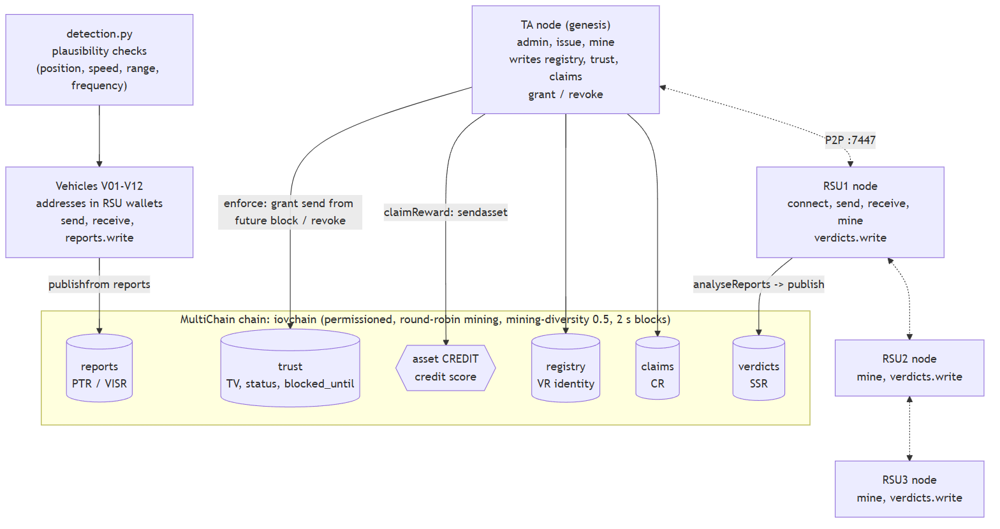
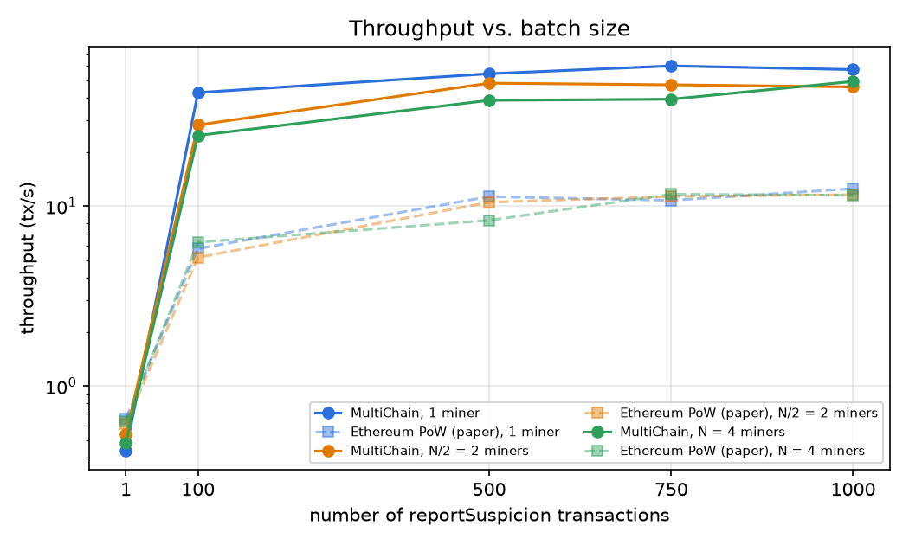

# IoV Adaptive Trust Management on MultiChain

Re-implementation of

> P. K. Singh, R. Singh, S. K. Nandi, K. Z. Ghafoor, D. B. Rawat, S. Nandi, "Blockchain-Based Adaptive Trust Management in Internet of Vehicles Using Smart Contract," *IEEE Transactions on Intelligent Transportation Systems*, 2020. DOI: 10.1109/TITS.2020.3004041

The paper uses an Ethereum smart contract (PoW, geth) for RSU-based trust management. This project moves the same trust model (Algorithms 1–3) onto a **permissioned MultiChain network**:

- RSUs are **round-robin miners**.
- Vehicle identities and revocation are **MultiChain permissions**.
- The contract's registers are **streams**.
- Credit scores are a **native asset**.

It also adds the two items from the paper's conclusion:

| Paper (Sec. 8) | This repo |
|---|---|
| Limitation: *"we have not considered the misbehavior detection and local detection checks using plausibility factors, filters, consistency (position, speed, heading), beacon frequency"* | [detection.py](detection.py): speed, radio-range, position-consistency and beacon-frequency checks produce the reports |
| Future work: *"efficient consensus algorithms in the RSU plane"* | PoW is replaced by MultiChain's permissioned round-robin consensus among RSU nodes. [benchmark.py](benchmark.py) repeats the paper's Fig. 9/10 experiment with 1, N/2 and N miners |

## Architecture



| Paper (Ethereum) | MultiChain |
|---|---|
| Traffic Authority (deploys contract, `configureVEH`, `configureRSU`) | TA node = genesis node with `admin`. Registers vehicles with `grant` |
| RSU (miner, calls `analyseReports`) | RSU node with `connect,send,receive,mine` + `verdicts.write` |
| Vehicle OBU (light node) | Address held by its RSU node's wallet, with `send,receive` + `reports.write` |
| `OnlyTA` / `OnlyRSU` / `intelligentVehicle` modifiers | Permissions checked by every node (`admin`, `verdicts.write`, `reports.write`) |
| PTR / VISR (reports) | `reports` stream, keys = session, `suspect:<addr>`. Publisher = reporter |
| SSR (score, verificationResult) | `verdicts` stream, key = session |
| VR (TV, Revoked, block time) | `trust` stream, key = vehicle address (latest item = current state) |
| CR (claimable rewards) | `claims` stream, key = `session:address` |
| creditScore (ether) | `CREDIT` asset (open, issued by TA) |
| `notBlocked`: blocked 1 minute | `grant <addr> send 0 <height+30> …`: chain rejects the vehicle's tx for 30 blocks (2 s each) |
| `RevocationList` (TV < 0) | `revoke <addr> send,receive` + `reports.write`: chain-enforced |
| PoW (geth) | Permissioned round-robin, `mining-diversity = 0.5`, 2 s target block time |

More figures are in [docs/figures/](docs/figures/) (Mermaid sources included).

## Trust rules implemented ([trust_contract.py](trust_contract.py))

- **Alg. 1 `report_suspicion`:** reporter registered, not revoked, not blocked; suspect registered; no duplicate (reporter, session, suspect).
- **Alg. 2 `analyse_reports` (RSU) + `enforce` (TA):** `count` = distinct reporters. A suspect is guilty if `count >= 4` and `score > count/2`. Then TV −1:
  - TV ≥ 0: soft-block for 1 minute.
  - TV < 0: hard-revoke.
  - The TA re-computes the tally from the chain before applying the RSU's verdict.
- **Alg. 3 `claim_reward`:** a reporter whose report matches the verdict gets +5 CREDIT and TV +1; the first reporter (alarmer) gets +2 more. One claim per session.
- **TA `reinstate`:** only the TA can readmit a revoked vehicle.

Where the paper is ambiguous, these choices were made:
- Initial TV is 1 (not given in the paper).
- `count` excludes the off-by-one start value of 1 in Alg. 1.
- A suspect is punished once per session, not once per report naming it.
- The block runs until *now* + 1 minute (the paper writes `v.time + 1 minutes`).

## Requirements

- Windows/Linux, Python ≥ 3.9 (standard library only; `matplotlib` for plots)
- MultiChain 2.3.x Community: https://www.multichain.com/download-community/. Put the binaries in `../multichain/`, or set `MULTICHAIN_BIN`, or put them on `PATH`.
- Ports 7446–7477 free on localhost

```bash
pip install -r requirements.txt
```

## Run

```bash
python network.py setup      # chain + TA + 3 RSU nodes + streams + CREDIT + 12 vehicles (~1-2 min)
python network.py status     # all 4 nodes mining and connected
python detection.py          # self-check of the plausibility detector
python simulate.py           # end-to-end scenario -> results/scenario_log.txt
python benchmark.py 3        # Fig. 9/10 experiment, 3 runs, 4 parallel clients -> results/benchmark.csv (~12 min)
python plot_results.py       # -> results/fig_execution_time.png, fig_throughput.png, summary.md
python network.py stop       # stop nodes   (start / reset also available)
```

`simulate.py` needs a fresh network (`python network.py reset && python network.py setup`).

Optional GUI: point [multichain-web-demo](https://github.com/MultiChain/multichain-web-demo) at the TA node (`rpcport=7446`, user `multichainrpc`, password from `network.json`) to browse the streams, permissions and the CREDIT asset.

## Scenario (results/scenario_log.txt)

1. **E1:** V11 sends fake positions and V12 fake speeds; V10 falsely accuses V03.
   - 9 of 10 reporters flag V11 and V12, which are convicted: TV 1 → 0, soft-blocked.
   - V03 gets 1/10 and is not punished.
   - V12's direct `publishfrom` is **rejected by the chain** (`doesn't have send permission`).
   - Honest reporters get +5 (alarmer +7); V10's claim is refused.
2. **E1c:** 3 colluders accuse V05. That is below the 4-participant minimum, so there is no punishment.
3. **E2:** V11 keeps attacking: TV −1, **hard revoked**. Blocked V12 can't report.
4. After 30 blocks V12 can transact again, and V11 is still rejected. The TA reinstates V11.

## Performance (results/summary.md)

Each batch of reportSuspicion transactions was run 3 times with 4 parallel clients:

| miners | 1000 tx exec time | paper (Ethereum PoW) | throughput @1000 tx | paper |
|---|---|---|---|---|
| 1 | 17.5 s | 80.1 s | 57.3 tx/s | 12.5 tx/s |
| 2 | 22.0 s | 86.4 s | 45.9 tx/s | 11.6 tx/s |
| 4 | 20.4 s | 87.2 s | 49.3 tx/s | 11.5 tx/s |

The confirmation lag (last submission → last confirmation) is about 1–4 s, i.e. one block. As in the paper, more miners don't increase throughput; they add decentralization.



## Files

| File | Purpose |
|---|---|
| `mcrpc.py` | JSON-RPC client |
| `network.py` | Chain/node setup, start/stop/status/reset |
| `trust_contract.py` | Algorithms 1–3, enforcement, reinstatement |
| `detection.py` | Vehicular-plane plausibility checks + beacon simulation |
| `simulate.py` | End-to-end scenario |
| `benchmark.py`, `plot_results.py` | Performance experiment and plots |
| `results/` | Logs, CSV, plots from our run |
| `docs/figures/` | Architecture, workflow, sequence and state diagrams |

## Limitations

- MultiChain has no Turing-complete contracts. Algorithm logic runs in Python on the RSU/TA nodes; only permissions are enforced by consensus.
- Vehicle keys are held by RSU node wallets (no light client in MultiChain).
- All nodes run on one machine.
- Sharding / LEAVE-REGION is not implemented.
